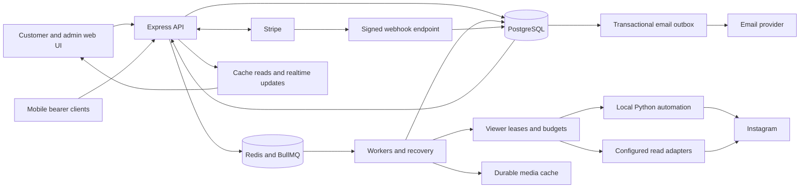
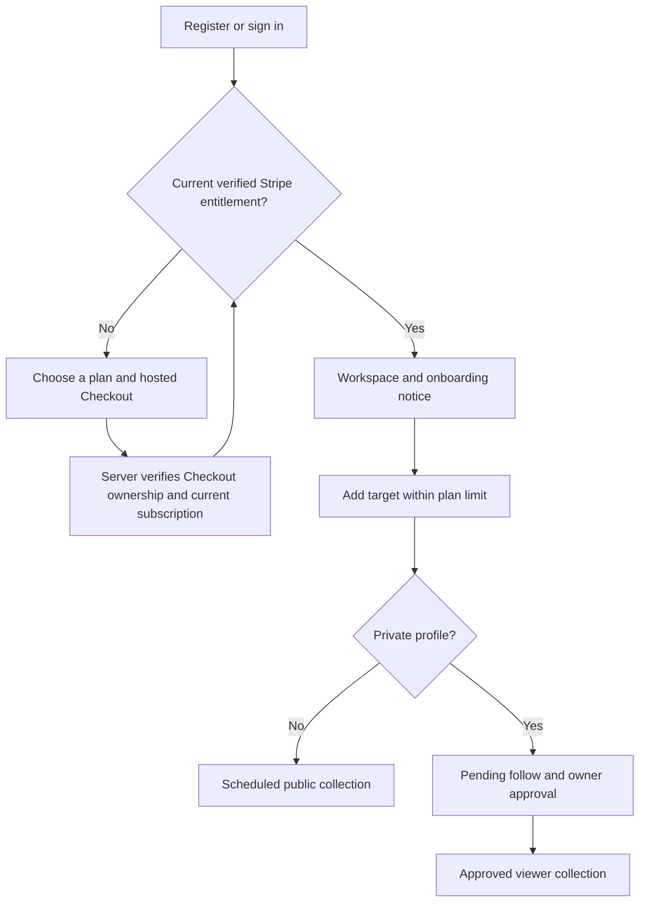

# CheaterFinder platform guide

This guide describes the current repository implementation. Current deployment evidence is in the [trial-payment review release](evidence/2026-09-24/trial-payment-review-release.json): the 99-cent offer remains enabled with retained credit on cancellation, and the focused financial-event and payment-summary fixes are live. The earlier [admin content/media audit](admin-media-audit-2026-09-24.md) and [media release record](evidence/2026-09-24/admin-media-release.json) retain their dated observations. The [zero-post collection audit](zero-post-collection-audit-2026-09-24.md) records saved-count presentation, filtered pagination and actual reader-capacity findings; its [release record](evidence/2026-09-24/zero-post-collection-release.json) separates deployment and live checks from code validation. Earlier cross-flow validation remains in the [prior audit and release record](flow-audit-2026-09-23.md). A successful build, an approved private follow, a completed queue job, provider acceptance of an email and a customer's receipt of that email are different facts.

## What the platform observes

CheaterFinder stores observations from Instagram and presents them in an authenticated customer workspace. It does not guarantee a complete or immediate history of an account's activity. Results depend on profile privacy, owner approval, viewer health, endpoint restrictions, request budgets and the time collection succeeds.

| Feature | Stored or displayed result | Meaningful limit |
| --- | --- | --- |
| Profile | Identity, available profile details and count snapshots. | A fresh profile does not prove that posts or rosters refreshed. |
| Posts and reels | Available media metadata, captions and engagement observations. | Normal collection targets 12 recent posts per cycle; this is not a full historical archive. |
| Stories | Available story items and cached media. | A story that expired before collection cannot be reconstructed. |
| Highlights | Highlight metadata, item caches and media. | Missing or restricted item reads must not be interpreted as an empty highlight. |
| Followers/following | Held membership, recent observations, complete-scan evidence and changes. | A count or partial page is not complete enumeration. |
| Observed likes | Positive evidence associated with a target, collected through available feeds, reels and sampled accounts. | Observation time is not necessarily the exact time the person pressed Like. Unobserved activity remains unknown. |
| Post likers/comments | Available engagement on a specific post. | A post's liker list is different from the tracked person's own liked-post history. |
| Reports | Period activity, cached-post counts, growth where measurable, PDF and CSV. | Reports describe retained observations; missing evidence is not zero activity. |

Private follow requests are visible to the owner. Each additional service account needs independent approval. Private content is unavailable until an approved viewer can actually read it; a backup request by itself grants nothing.

## Architecture



The web client uses React, TypeScript, Vite, TanStack Query, Wouter, Tailwind and shared UI components. Express owns HTTP authorization and service composition. Drizzle models PostgreSQL state. Redis/BullMQ carries work, while database records retain business state, access grants, collection progress and durable delivery intents.

The Python FastAPI service binds to loopback and requires the shared automation token. It owns browser identity and fingerprinted transport for configured web viewers. A saved identity, session and assigned proxy must remain consistent. Mobile read sessions are an explicit separate transport; a private read cannot silently replace its approved web viewer with an unrelated public mobile account.

Transport setting names need care: `SCRAPER_READ_TRANSPORT`/`scraper.readTransport`
selects `http`, `browser`, `browser-fallback` or `http-first`. The legacy browser
adapter performs API requests in a browser context; that is distinct from native
UI capture. `browser-fallback` explicitly permits HTTP fallback. The optional
`IG_MEDIA_BROWSER_FALLBACK_ENABLED` path allows one same-viewer native UI retry
for eligible generic media failures on the plain HTTP path; it does not bypass
authentication failure or throttling. `IG_NATIVE_PUBLIC_READS_ENABLED` and
`IG_NATIVE_PUBLIC_TARGETS` select supported native public reads. None of these
settings grants a viewer access to a private account.

The main files are:

| Boundary | Source |
| --- | --- |
| HTTP bootstrap, workers switch, middleware | [server/index.ts](../server/index.ts) |
| Web and mobile credentials | [auth.ts](../server/auth.ts), [mobile-auth.ts](../server/mobile-auth.ts), [customer-credentials.ts](../server/services/customer-credentials.ts) |
| Entitlement | [billing-plans.ts](../shared/billing-plans.ts), [subscription-access.ts](../server/services/subscription-access.ts) |
| Customer/admin routes | [routes.ts](../server/routes.ts), [admin-routes.ts](../server/admin-routes.ts) |
| Billing synchronization and locking | [stripe.ts](../server/stripe.ts), [customer-billing-lifecycle.ts](../server/services/customer-billing-lifecycle.ts), [billing-retention.ts](../server/services/billing-retention.ts) |
| Assignment and approval state | [bot-manager.ts](../server/bot-manager.ts), [follow-request-state.ts](../server/domain/follow-request-state.ts) |
| Collection and completeness | [public-data-collector.ts](../server/services/public-data-collector.ts), [collection-completion.ts](../server/services/collection-completion.ts) |
| Rosters | [roster-store.ts](../server/services/roster-store.ts), [roster-background-sync.ts](../server/services/roster-background-sync.ts) |
| Reports and delivery | [report-data.ts](../server/services/report-data.ts), [report-delivery.ts](../server/services/report-delivery.ts), [transactional-emails.ts](../server/services/transactional-emails.ts) |
| Queue orchestration | [workers.ts](../server/workers.ts), [recovery-watchdog.ts](../server/services/recovery-watchdog.ts) |

### Durable state

- `users`, browser `session` rows and mobile session records hold customer identity and revocation state.
- `subscriptions` links each customer to verified Stripe state; dates determine whether access has ended even when a webhook is late.
- `tracked_accounts` holds the customer's tracking row, activity flag, privacy and access status. Public cache reuse does not transfer ownership.
- `bot_accounts` holds encrypted sessions/credentials, identity, transport, tier, health, capacity and proxy binding. `bot_follow_requests` binds a viewer to one tracked row.
- `profile_snapshots`, media caches and activity-event tables retain observations. Roster state holds cursors, viewer identity, epochs and completeness evidence.
- `collection_jobs` records work outcomes. `backend_operation_leases` provides cross-process ownership with renewal and fencing.
- `reports`, notifications and `transactional_emails` retain report results and delivery intent. `billing_retention_offers` retains the one-time offer state.
- `system_settings` holds supported operational settings. Runtime readers do not create that table; deployment provisions it.

The canonical schema is [shared/schema.ts](../shared/schema.ts). Do not infer an exact database inventory from an older audit or run an automatic schema push against production.

## Authentication, authorization and onboarding

Browser registration normalizes the email, hashes passwords with bcrypt, creates the customer and welcome-email intent transactionally, then establishes a regenerated session. Browser mutations use authentication and CSRF checks. Cross-site authentication writes are rejected. `/api/auth/me` can restore a missing companion CSRF cookie after validating the session without rotating an already valid token beneath concurrent requests.

Mobile authentication is additive. Access tokens expire after one hour and refresh tokens after 60 days. Tokens bind to password state and a revocable device session; refresh rotates once and logout revokes the family. These bearer requests do not use the browser's ambient-cookie CSRF mechanism. A browser session and a mobile token must still pass the same customer/admin ownership boundaries.

Password-reset requests return a generic response. A one-hour, single-use token is stored only as a hash. A successful reset/change revokes the applicable existing sessions and other reset links. Reset email delivery is inline and bounded, rather than placing a plaintext reset token into the general outbox. An email-provider error is not reported as confirmed delivery.

Email links can preserve an allowed customer destination through password sign-in
or the forgot-password round trip. [shared/auth-return.ts](../shared/auth-return.ts)
accepts known internal customer pages, preserves their query/hash and rejects
external URLs, protocol-relative paths, encoded separators and auth/API routes.
Successful authentication clears the prior query cache before establishing the
new account's state. Billing/report links therefore return to their intended
customer page after sign-in; admin sign-in returns to the admin area. This
navigation does not bypass entitlement or report/private authorization.

The customer path is:



A success redirect alone grants no access. The server confirms Checkout against Stripe, checks its owner and reconciles the current subscription. Onboarding acknowledgement is stored on the customer; the initial account-data notice is separate from proof of successful collection.

Tracked-content routes require the owning customer, an active tracked row, a current paid subscription or valid Stripe trial, and private access where applicable. Admin routes add role checks. Billing and settings remain available for the customer to manage an ended subscription. Never use a manual local subscription row or a cached private twin as a substitute for authorization.

## Billing and the cancellation offer

The [shared catalog](../shared/billing-plans.ts) supplies UI prices and tracking limits. New Checkout accepts only these monthly plans:

| Plan | Catalog monthly amount | Account limit | Anchor before configured founders discount |
| --- | ---: | ---: | ---: |
| Starter | $11.99 | 1 | $16.99 |
| Standard | $19.99 | 3 | $27.99 |
| Pro | $34.99 | 6 | $44.99 |

Legacy weekly/monthly plans remain recognizable for existing subscriptions; they are not new Checkout choices. The weekly legacy catalog amount is $7.95 and monthly is $19.99, both with three accounts. Taxes and the actual next invoice come from Stripe, not a hard-coded UI calculation.

An eligible customer can receive a three-day trial. Checkout always collects a payment method. Trial history and existing remote subscriptions are checked to prevent a fresh trial or duplicate active subscription on every retry. Compatible open Checkout sessions are reused; owned superseded sessions can be expired. Customer linkage is persisted before returning a Checkout URL.

The **US$0.99 upfront trial payment and matching invoice credit are enabled for eligible new trials**. The live cancellation policy is `retain_credit`: unused advance stays as invoice credit, with no automatic cash refund. The [billing guide](trial-payment-credit-2026-09-24.md) covers the durable ledger, explicit Checkout consent, scoped founders coupons, net invoice previews, cancellation, deletion and email behavior. Existing subscription agreements retain their terms. A successful small payment does not establish future subscription funds or card authenticity; the [earlier live decline audit](trial-payment-verification-audit-2026-09-24.md) remains a separate historical observation.

The [20:03 UTC activation record](evidence/2026-09-24/trial-payment-live-activation.json) confirms the running flag is on, dedicated catalog/settings resources are verified, and the seven additional webhook event subscriptions are enabled. Card, Apple Pay and Google Pay are the permitted methods in the dedicated configuration; Scalapay is explicitly off. The existing management portal cancels at period end. Coupon product restrictions are expanded before validating trial, retention and existing founders discounts; ordinary Stripe retrieval omits that field. Focused tests, typechecks, build and a short live browser check passed. Actual card capture, credit consumption at renewal and signed delivery of the new events were not exercised during activation.

For the new cohort, `trialing` alone cannot unlock access: captured payment and the matching one-time credit must be verified. The ledger survives deletion of the customer record, and a disabled rollout flag does not turn off reconciliation for an already accepted offer. Invoice balance applies to the next applicable invoice; a plan change may consume it before the first monthly renewal. Billing displays the actual amount due and distinguishes historical credit issuance from a remaining balance.

Access requires valid `cus_` and `sub_` links plus either `active` with a future current-period end or `trialing` with a future trial end. There is no free tracking allowance. Expiry is enforced by the clock as well as subscription events. A saved payment method proves neither a successful charge nor guaranteed renewal.

Signed Stripe webhooks and Checkout confirmation reconcile current provider state. Duplicate or older events must not replace a newer subscription. The configured `/api/webhooks/stripe` endpoint includes the supported Checkout, subscription and invoice events, including `invoice.payment_action_required`, listed in [routes.ts](../server/routes.ts). The additional asynchronous Checkout success/failure, charge refund/dispute and refund create/update/failure events were enabled during activation. The existing URL, API-version setting and signing secret were preserved. Configuration verification is separate from exercising signed delivery of those new events.

### One-time retention offer

When an eligible customer opens cancellation, the server may quote **50% off one monthly subscription payment**. The quote verifies ownership, a supported single monthly licensed item, the same next invoice period and a provider-derived amount. It preserves supported existing forever discounts in order.

Quotes are not available for every account. Unsupported invoice shapes, inherited customer discounts, item-level or limited-time discounts, pending plan changes, scheduled cancellation, weekly plans, past-due debt and a previously used offer can make the offer unavailable. Cancellation remains a separate action and must remain usable when the optional quote is slow or unavailable.

A quote expires after 15 minutes. Acceptance revalidates the subscription and invoice, records frozen provider parameters, and uses a stable provider idempotency key. The durable ledger moves through `quoted`, `pending` and `applied`; ambiguous older attempts require review instead of an unbounded replay. Acceptance does not change the billing date or trial end and requests no proration or immediate charge. It is not a discount on an already failed invoice.

The deterministic coupon was provisioned in the verified live Stripe account. A read-only trial preview reduced the next invoice from 1,999 to 999 USD minor units while preserving its existing discount; the subscription itself was unchanged by that readiness check. See [provider evidence](evidence/2026-09-23/retention-provider-readiness.json). This is not evidence of a paid renewal or a customer accepting the offer.

## Private-account lifecycle

Private authorization belongs to the original customer tracking row and the precise viewer whose follow was accepted.

| State or event | Backend behavior | Customer meaning |
| --- | --- | --- |
| Private target without access | Reserve one eligible viewer and create a queued follow request. | A request may still be waiting to send. |
| `queued` request | Shared capacity/cooldown/action controls apply before submission. | Sending is not approval. |
| `pending` request | Check the requesting viewer's relationship under the shared lease and read budget. | Owner approval is still required. |
| Accepted relationship | Commit request acceptance, target `has_access` and the first notification together. | Approval is confirmed; the notice says data appears after collection succeeds. |
| Interrupted approval handoff | Reconcile the accepted grant and enqueue a stable full-collection job. | Recovery does not send another follow. |
| Session unavailable or viewer cooling | Defer or use another independently approved healthy viewer. | A transport error does not mean the owner revoked access. |
| Explicitly removed relationship | Revoke that viewer using a compare-and-swap and release its capacity once. | Another approved viewer may preserve access. |
| No surviving accepted viewer | Keep pending access if another request remains; otherwise expose unavailable access/retry. | A retry can create another visible request. |
| Tracking/subscription ended | Deny reads and stop ineligible work. | Cached private data is not permission to continue. |

### Admission and follow submission

Primary, backup and rotation decisions serialize per target. They require an active entitled private row and a usable web viewer with a matching saved identity, a nonempty session, a durable proxy, capacity and no active cooldown. New follow assignments prefer workers, then canaries; reserve/retired accounts are excluded. Historical viewer attempts are excluded from primary fallback as well as rotation, preventing a duplicate unique-key failure or reusing a stopped request.

The backup sweep aims for one primary and one independent backup after the primary has actually reached pending/accepted state. An existing queued backup is reused after interrupted Redis dispatch. Three stopped attempts limit automatic backup churn. Pending requests expire after seven days and follow the controlled expiry/rotation path. These safeguards are not a promise that a backup will exist or be accepted.

An explicitly requested browser follow cannot silently fall through to a second HTTP write after an uncertain response. Transient failures do not revoke accepted relationships. Compare-and-swap transitions and row locks prevent duplicate capacity release under concurrent cancellation, expiry or failure.

### Approval polling and private reads

Approval polling uses the exact still-pending request, customer target and requester. Authorization is rechecked after obtaining the read lease and after the relationship response. A public profile alone is not acceptance. Legacy numeric-ID resolution remains on that same requester.

Profile, posts, stories, highlights, rosters and engagement reads use a healthy accepted viewer. Every pinned lease checks current status, tier, session identity, proxy and cooldown. Read quotas, endpoint breakers and operation ownership still apply. A later collection leg cannot ignore a cooldown set by an earlier leg.

Unknown relationship fields stay unknown. Only explicit relationship evidence can revoke an accepted grant. A session error, empty body, timeout, rate limit or missing field is not such evidence. A backup must have its own accepted grant; public twins and arbitrary pool viewers never supply private authorization.

Cursors are viewer-bound. Changing the viewer starts the relevant traversal safely instead of continuing another viewer's cursor. Access is rechecked between pieces, provider pages and persistence boundaries. Invalid or failed response envelopes cannot become empty success. A full empty private feed/roster contradicting positive profile counts is reported as unavailable/incomplete; legitimate zero counts and an empty final continuation page remain distinguishable.

When every otherwise usable approved reader is cooling, collection schedules an idempotent wake-up just after the earliest known expiry. Persisted identities and proxy durability are validated before predicting availability. At execution, current entitlement, private access and reader health are checked again; a newer successful full collection suppresses redundant recovery. An owner approval wait or terminal session failure does not invent a cooldown expiry.

### Customer-visible state

The dashboard distinguishes pending approval from approved-but-unavailable content. Failed Retry Access requests display their error and prevent duplicate in-flight submissions. Account state is refreshed from stored API data without reloading the page. Member cards prioritize inactive status over private-active or sync-pending badges.

`has_access` means a recorded approved relationship. It does not certify a healthy session, a complete roster, a fresh story list or successful media downloads. Treat those as separate readiness checks.

## Public collection, rosters and activity accuracy

The normal pipeline obtains a profile anchor, then collects independent content dimensions and records per-dimension outcomes. A useful cached anchor can support bounded continuation, but persistent failures cannot indefinitely report success. Collection completion aggregates the actual results and schedules recovery where appropriate.

Public cache reuse is limited to eligible public twins. A private donor is excluded, ownership is retained, and access is checked again when serving events/media. Public profile freshness does not make every shared roster complete.

A local posts-pool rejection after a successful profile remains a partial failure. A known future reader cooldown, UTC quota reset, operation lease expiry or endpoint breaker expiry can schedule recovery. This forecast does not reserve a reader: the normal transport, session, proxy, quota and ownership gates still decide at execution. The browser UI path retains its explicit feature/canary policy. Recovery cannot enable a different transport or create follow requests when the target becomes private.

Regular collection targets 12 recent posts. Older-post loading is a separate bounded path: up to four pages in one request, with a deep-cache cap of 96 posts. Low-level post walks also reject missing/repeated cursors and continuing empty pages; later pages consume quota. These bounds explain why a profile post count can exceed the recent cache. They do not prove there are no newer upstream posts.

Customer post-type filters apply before the 24-item preview limit and paginate the full canonical saved cache. Filtered requests do not collect more upstream history; All retains the bounded older-history path. Counts and weekly saved-post totals cover the full saved cache rather than the preview. Public collection rejects an empty feed when current or fallback profile evidence reports a positive post count, preserving saved posts and their freshness anchor.

The customer and admin posts notice distinguishes saved posts from the dated recorded profile count and shows pending access, never-collected, collecting, delayed, failed or unavailable states. Historical profile zeros can be defaults for absent provider fields; they are not proof of an empty Instagram account. A completed profile job can also skip private content. Scheduled-check dates come from verified existing delayed jobs, not a forecast of successful provider access. A saved/read timestamp may include a nonempty profile preview and does not certify complete collection. See the [zero-post audit](zero-post-collection-audit-2026-09-24.md) for the evidence and remaining live capacity limits.

Roster state separates recent checks, partial progress, verified complete reads and serving membership. Pages save observations and the viewer-bound cursor transactionally. A failed or short walk preserves existing members. Completion is based on the reconciliation verdict, not merely the provider's `has_more=false` or a successful HTTP status.

A failed first background batch advances both bootstrap retry clocks, allowing other due targets to run. Temporary reader unavailability preserves its saved cursor; a structurally invalid reader requires a fresh authorized reader and a new pagination epoch.

For example, a walk returning 369–413 members against an existing 481-member baseline cannot be marked fully complete merely because the provider stops paginating. The saved roster remains protected, absence does not become an unfollow, and complete-success timestamps do not advance. The job exposes incomplete coverage for later recovery.

Initial baselines, tracking-start windows, settled roster state and event reconciliation prevent seeded history or contradictory follow/unfollow observations from becoming customer activity. Like evidence uses its configured observation window; it must not be relabeled as an exact historical action timestamp.

Media caching validates allowed destinations and stores successful assets durably. Renewed signed URLs can reuse stable cache keys. Failed downloads propagate failure/retry; a cached metadata row is not proof that media bytes exist. Private media refresh uses approved access, and application media links remain bound to current customer/target authorization. An external CDN URL already disclosed to a browser has separate bearer semantics.

The admin tracked-account drawer exposes saved posts, stories, highlights, liked posts, followers, following and scoped activity through dedicated admin reads. Public paused history remains available to support operators; private content requires the selected row's current access and owner entitlement. Opening the drawer does not start collection. Image delivery can reuse intact durable files after the original CDN URL expires, and customer Activity uses customer-bound cached thumbnails. Missing image bytes remain explicitly unavailable. See the [admin content and media audit](admin-media-audit-2026-09-24.md) for verification and rollout status.

## Reports and notifications

Requested weekly/monthly reports use explicit observation windows; monthly is a rolling 30-day report. Scheduled weekly windows derive from the queued scheduled occurrence rather than the time a delayed worker happens to run. Stable report/job IDs prevent retries from shifting a window or producing duplicate delivery intents.

Aggregation counts all cached own posts inside `[periodStart, periodEnd)`, independently of a smaller displayed top-post sample. Follower/following growth needs two distinct snapshot times. With insufficient evidence, growth remains unknown in views, email and PDF. Missing niche or peak-hour evidence does not create a placeholder fact. CSV uses the same period/tracking/settlement boundaries and neutralizes spreadsheet formula prefixes.

For reports generated with delivery enabled, readiness and the first notification commit together, along with an email intent when the customer enables report email. The initial dashboard report can be generated without delivery. Re-running generation for an existing ready report does not create a new historical email. Download builders use current code; historical stored metrics are not silently rewritten from a newer or retention-pruned cache.

Report reads and sending recheck ownership, active tracking, entitlement and private access. Report email also respects the customer's email preference. In-app notifications remain durable; device push is a best-effort nudge. Neither a notification row nor a queued email proves that the customer received a message.

## Transactional email

| Event | Intent and delivery rule |
| --- | --- |
| Welcome | Recorded with account creation; not replayed for all historical users on startup. |
| Membership | Recorded with synchronized billing state; superseded states are skipped. |
| Trial ending | Current future trials within three days, excluding scheduled cancellation. |
| Payment failure/action needed | Recheck current subscription, latest open invoice, attempt and payment state before sending. |
| Retention confirmation | Only a confirmed applied offer on the current eligible subscription. |
| Report ready | Durable report intent; recheck customer email, report ownership/access and email preference. |
| Password reset | Bounded inline delivery with a one-use hashed reset token; generic public response. |

The PostgreSQL outbox owns delivery intent; Redis wakes the processor. The sender claims at most five due messages per flush, freezes recipient/sender/body, and sends with a stable provider key. There are at most six attempts, and ambiguous retries stop before the provider's 24-hour idempotency horizon. The 23-hour window starts at `first_attempt_at`, not row creation. An old never-attempted intent can still be eligible; an old ambiguous attempted delivery needs investigation rather than blind replay.

Provider acceptance, skipped/superseded status and unconfirmed delivery are separate states. Existing legacy queued report jobs preserve their original delivery key/body and earliest ambiguous-attempt age when imported. Conflicting legacy payloads require review. There is no application inbox-delivery or bounce webhook proving end-to-end receipt.

Production email links use the configured first-party HTTPS origin, not a request's Host header. The configured sender must use the first-party domain. HTML and plain text share the same content; external values are escaped. Billing links target the billing settings tab. See [email-config.ts](../server/services/email-config.ts), [email-templates.ts](../server/services/email-templates.ts) and [email-delivery.ts](../server/services/email-delivery.ts).

No bulk past-due campaign is implied by these transactional flows. The [past-due recovery draft](past-due-recovery-draft-2026-09-23.md) is a separate, unsent operational proposal.

## Scheduling and operational controls

Important queue families include profile/likes/follows, background rosters, report generation, email, follow submission/checking, retention, refresh sweeps, cooldown probes and pool recovery. Additional liked-evidence and watcher jobs have their own controls; this is not a five-worker system.

Refresh configuration resolves from database settings, environment and defaults. The base configurable refresh interval defaults to 30 minutes and is bounded between one minute and one day. Content/graph freshness, account staggering, quotas, endpoint restrictions and retry clocks can defer actual collection beyond that interval. The private approval sweep runs every 30 minutes; the transactional outbox wake-up runs every 30 seconds. These are scheduling intervals, not delivery SLAs.

The recovery watchdog serializes its sweeps and isolates scheduler, collection and report recovery failures. Stale pending jobs, failed queue insertion or an interrupted grant can be recoverable without repeating a social action. A queue being unpaused or a worker being online does not establish fresh customer data.

Scheduler reconciliation counts only successful queue registrations and exposes failed additions/removals to the watchdog after completing independent repairs. Profile jobs share a renewing per-target operation lease across normal refreshes and deferred recovery. Recovery jobs preserve the time the blockage was observed, so a later complete collection can suppress an obsolete retry while a newer partial failure remains recoverable.

Admin collection health separates pending approval, denied access, profile bootstrap, unavailable approved readers and provider blocks. Roster freshness uses only entitled, authorized targets with a numeric profile ID and saved snapshot. Private rows remain separate per customer target; eligible public twins can share a canonical row. Blocking states remain visible and prevent a green verified status, even when they are outside the stale-roster denominator.

Use worker/canary/reserve/retired tiers deliberately. Persist session refreshes only when the observed encrypted session and identity still match; a concurrent renewal/admin change wins. Keep the approved viewer's proxy continuity. Preserve finite quotas, breakers and cooldowns during troubleshooting. The dedicated controlled cooldown probe is a separate guarded diagnostic; ordinary private content reads cannot use it to bypass a cooldown.

## Configuration

Use [.env.example](../.env.example) for names and [source defaults](../server/index.ts) for behavior. Environment values can be overridden by the process manager; inspect the effective configuration without printing secrets.

| Group | Principal settings and checks |
| --- | --- |
| Application | `NODE_ENV`, `PORT`, `APP_URL`, `HTTPS_ENABLED`; production email origin must be first-party HTTPS. |
| Persistence | `DATABASE_URL`, `REDIS_URL`; dedicated development/test services, statement and transaction timeouts. |
| Browser/customer auth | `SESSION_SECRET`; optional separately managed `MOBILE_JWT_SECRET`. |
| Viewer encryption | Distinct `SESSION_DATA_KEY` and `BOT_CRED_KEY`; preserve existing keys unless performing a planned rotation. |
| Stripe | Secret key, webhook secret, current monthly price IDs and retained legacy IDs; mode/account consistency. |
| Pricing verification | `STRIPE_EXPECTED_ACCOUNT_ID`; scripts reject mismatched account, currency, interval or catalog totals. |
| Email | `RESEND_API_KEY`, `EMAIL_FROM`, `APP_URL`; domain verification and provider acceptance are operational checks. |
| Local automation | `AUTOMATION_API_URL`, shared `AUTOMATION_API_TOKEN`; bind the service to loopback. |
| Background work | `WORKERS_DISABLED`, cadence settings, endpoint budgets, tier and watcher policies. |
| Optional transport | `PINNED_WEB_MOBILE_READS_ENABLED`, `IG_MEDIA_BROWSER_FALLBACK_ENABLED`, `IG_NATIVE_PUBLIC_READS_ENABLED`; opt in only after targeted verification. |
| Optional paid fallback | `APIFY_GRAPH_FALLBACK_ENABLED`, bounds and refresh controls; public fallback does not grant private access. |
| Retention/analytics | `RETENTION_DAYS_EVENTS`; browser analytics requires the configured public project token and visitor consent. |

Placeholder credentials are not proof of working integrations. Billing fails closed. Offline verification comes from explicit fixtures and network isolation, not fabricated production results.

## Deployment, migrations and rollback

### Prepare an immutable release

1. Freeze the intended source and dependencies. Record commit, artifact hashes and the exact tests that ran against them.
2. Build in an inactive checkout/staging directory with Node 22.19+. The normal build replaces `dist/`, prerenders public pages and bundles the server/metrics entry points. Preserve required external Node modules and the Python automation package/dependencies.
3. Capture the current release, effective environment, process identities, queue pause states and assets needed by already-open browser tabs. Do not print credentials or rotate session/proxy identities as a side effect of deployment.
4. Create a database backup and verify a restoration in an isolated destination. A successful backup command alone is not a restore test.
5. Review schema drift and migration role privileges before the maintenance window. Migrations and app-role ownership/DML checks precede startup of code that needs the new tables.

### Required additive migrations

| Migration | Required objects |
| --- | --- |
| [0056](../migrations/0056_transactional_email_outbox.sql) | Durable system settings and transactional email outbox/index. |
| [0057](../migrations/0057_customer_retention.sql) | Onboarding acknowledgement and one-time retention-offer ledger. |
| [0058](../migrations/0058_trial_payment_credit.sql) | Nullable trial-payment policy, retention invoice breakdown and durable 99-cent payment/credit/refund ledger. Required before deploying its readers, even with the offer disabled. |

Apply only pending reviewed migrations in order. Existing installations also need their earlier schema migrations; these two files are not a complete fresh-database bootstrap.

```sh
psql "$MIGRATION_DATABASE_URL" -v ON_ERROR_STOP=1 --single-transaction -f migrations/0056_transactional_email_outbox.sql
psql "$MIGRATION_DATABASE_URL" -v ON_ERROR_STOP=1 --single-transaction -f migrations/0057_customer_retention.sql
psql "$MIGRATION_DATABASE_URL" -v ON_ERROR_STOP=1 --single-transaction -f migrations/0058_trial_payment_credit.sql
```

Use a migration role with the required ownership/reference privileges. Do not broaden the running application's permissions just to make startup DDL succeed. Verify table ownership and the application's required `SELECT`, `INSERT`, `UPDATE` and `DELETE` access after migration. Do not use `drizzle-kit push` as an unreviewed production migration plan.

Migrations 0056/0057 were applied for the verified 23 September first release; 0058 was applied on 24 September for the disabled trial-payment release. Verify their presence and expected schema when preparing another environment. Preserve runtime DML grants on newly created tables.

### Cut over and verify

- Preserve queue pause states, pause the affected work and allow active operations to settle within the documented maintenance bound.
- Switch only the intended application/automation release and preserve configuration, encrypted state, proxy bindings and unrelated services.
- Verify public HTTP pages, authenticated boundaries, database/Redis connectivity, automation readiness and artifact/runtime identity.
- Restore each queue's prior state. Check registration of recurring jobs, active leases, delayed retries and stale pending jobs.
- Observe existing authorized customer work. Compare profile/content/roster timestamps and completeness, not just process health or completed-job counts.
- Inspect outbox acceptance/skips/failures and report integrity. A health check or validation-only automation request is not a live Instagram content test.
- Use bounded provider diagnostics only when authorized, eligible and outside existing cooldowns. Stop on throttling/auth failures; do not create extra follows, charges or emails to manufacture evidence.

The current runtime `2b70f64` was deployed at **20:38:46 UTC on 24 September** with the 99-cent retained-credit offer still enabled. The follow-up fixes durable manual-review records for orphaned financial events and labels returning-customer amounts as estimates before existing invoice credit. Only the application process was replaced; active jobs drained first, queue pause states were restored, and automation/unrelated process IDs were preserved. The short live browser check verified the Standard payment screen, required consent and all three plan offers. Its temporary synthetic user/session was deleted and the token returned 401. The [review and evidence](trial-payment-review-2026-09-24.md) distinguish focused local regressions, a real unpaid Checkout amount/reuse check and live screen verification from untested card capture and renewal. No additional migration was required.

The earlier runtime `10e15ba` deployed the financial code and migration 0058 at **14:28:25 UTC** with the feature off. Its four existing-customer billing-screen checks, verified backup restoration and migration evidence remain in the [initial billing release record](evidence/2026-09-24/trial-payment-credit-release.json). The runtime database role's existing schema CREATE permission was observed and recorded; it was not added or removed by this migration.

The prior runtime `de82a91` was deployed at **08:35:08 UTC on 24 September**. It adds evidence-based post collection status, complete saved-cache type filters and protection against empty public feeds that contradict a positive profile count. It follows the mobile media release `3183a7d` at 08:07:32 UTC and the main media release at 07:33:05 UTC. The [zero-post release record](evidence/2026-09-24/zero-post-collection-release.json) records the latest cutover and live validation. These releases fix admin media authorization, use intact durable files for expired image URLs, and add the seven-tab account detail with saved posts, stories, highlights, liked posts, rosters and scoped activity. The followup also fixes mobile Activity wrapping and keeps long liked-post previews and their Close controls within the viewport. Live desktop/mobile Activity preview checks passed after the followup. The application and automation cutovers preserved environment configuration, unrelated processes and queue states. A production backup passed a full isolated restore; the existing schema required no new migration. See the [admin content/media audit](admin-media-audit-2026-09-24.md) and [release evidence](evidence/2026-09-24/admin-media-release.json) for live checks and the six sampled historical images awaiting a bounded retry.

After the zero-post cutover, all seven active entitled rows passed read-only database/helper reconciliation and 14 desktop/mobile admin checks, including 32 filter checks. Three were waiting for private approval and four were delayed; zero visible posts was not treated as verified upstream emptiness. Live customer media authorization also passed for public and approved-private cached assets, including tampered/cross-owner rejection and session revocation. Actual customer collection-page GETs were excluded because they can enqueue work; their route/browser validation uses isolated fixtures.

The prior `4bed8fc` release passed 44 live browser checks, and its temporary operator session was revoked. Its private cooldown and public posts-capacity recovery jobs were confirmed in the live queue. Those observations are retained in the [freshness recovery audit](stale-collection-recovery-2026-09-24.md) and [collection recovery evidence](evidence/2026-09-24/collection-recovery-release.json). Pending owner approvals and incomplete collection remain distinct from application health. Earlier billing/report/email evidence is retained in the [prior release record](flow-audit-2026-09-23.md).

### Rollback

Keep the previous matched application/automation artifacts, dependency configuration and asset set available. Pause affected queues, roll back the release selection, verify health and restore the recorded queue states. Leave compatible additive tables in place; dropping an outbox or financial ledger destroys recovery information. After a paid trial has been accepted, a binary rollback must retain its credit/refund reconciliation; turning off new offers is safer than returning to code unaware of those obligations.

A database restore is a separate incident operation: restoring an older backup can discard intervening subscriptions, grants, observations and delivery receipts. Reconcile durable provider-facing state before replaying jobs. Never replay ambiguous payments, follows or messages simply because the application binary rolled back.

## Operating playbook

| Symptom | Inspect first | Safe interpretation/action |
| --- | --- | --- |
| Private account waiting | Active entitlement, queued/pending request, `sent_at`, expiry and viewer state. | Queued is not sent; sent is not accepted. Preserve cooldowns and avoid duplicate visible requests. |
| Approved account has no posts | Exact accepted viewer, profile count, last content success, per-dimension job errors, session/proxy and endpoint cooldown. | Do not call the account empty or revoke approval from a transport failure. Use an approved healthy backup only. |
| Partial/stale roster | Last recent check versus last complete read, cursor/viewer, epoch coverage, retry clocks and retained count. | Keep held members; do not force completion or generate absence events from a short scan. |
| Missing numeric profile ID | Profile job outcomes, delayed retry, lease pool and browser/profile throttle. | A scheduled retry is progress evidence, not successful profile recovery. |
| Missing images | Current authorized references, media row/status, stored file and byte size, upstream CDN expiry and permitted host. App media signatures are checked against current access and do not expire by age. | Separate obsolete failures from currently affected content. Refresh within the existing access/quota path. |
| Unexpected tracking deactivation | Subscription end/cancel timestamps, local entitlement clock and target update time. | Compare to cutover; normal expiry can happen immediately before deployment. Do not reactivate an ineligible target. |
| Retry Access unavailable | Active request, historical viewer exclusions, eligible pool/capacity and stable queued request. | Preserve an already queued/accepted request; report unavailable capacity instead of resetting history. |
| Payment failed | Current invoice, saved payment method, SetupIntent/payment status, decline category and retry schedule. | A saved card can still be declined. An expired Checkout is not a canceled subscription. |
| Email pending or unconfirmed | Due time, attempt count, first-attempt age, frozen payload, provider receipt and current eligibility. | Suppress superseded messages; stop old ambiguous replays. Provider acceptance is not inbox receipt. |
| Report incorrect/stuck | Window, distinct snapshots, cached-post aggregation, job lease, access and atomic ready/outbox state. | Unknown growth stays unknown. Historical cache differences alone do not justify rewriting old reports. |
| Admin health degraded | Feature freshness, queue read errors, recovery heartbeat and usable viewer capacity. | Online HTTP/DB services alone cannot justify a healthy collection verdict. |

Read-only investigations should use explicit database read-only transactions, bounded queries, local queue reads and sanitized aggregates. Keep stable pseudonyms for the same audited target across observations; filtering an expired target before assigning row numbers can accidentally relabel another target. Customer identifiers, session cookies, raw content, proxy credentials and provider object IDs belong in neither public evidence nor logs intended for publication.

## Verification and evidence

Verification is layered:

1. Type checking and a production build validate source and artifacts.
2. Mocked unit/processor tests validate state transitions, transport routing and failure boundaries without provider calls.
3. Isolated PostgreSQL/Redis tests validate actual SQL, locks, rollback, capacity, queue boundaries and authorization under races.
4. Compiled browser fixtures validate user-visible behavior with synthetic APIs; this is not live authentication/payment proof.
5. Read-only live checks validate the current deployed state within their bounded scope. A successful upstream collection or payment requires its own evidence.

The [isolated runner guide](../tests/stress/README.md) documents setup, network restrictions, excluded suites and output. Missing/skipped evidence does not count as a pass. Focused reruns overlap the full suite and must not be added together as independent coverage.

The preceding media release passed **2,509 backend tests in 152 files**, with zero failed/pending tests, plus **18 compiled customer/admin browser flows**, **21 shared-media Chromium scenarios**, **12 admin-detail Chromium scenarios**, **15 image URL unit cases**, TypeScript and the production build. Source proof covers 460 runtime files. The mobile followup reran the compiled flows and shared-media suite against the new UI; its backend artifact is unchanged. Focused backend test results overlap the full run and are not added again. The [validation evidence](evidence/2026-09-24/admin-media-validation.json) and [live release evidence](evidence/2026-09-24/admin-media-release.json) distinguish synthetic browser behavior, actual deployed media authorization, production rendering and pending historical recovery.

Earlier private/report/email validation, including synthetic production PDF generation and email layouts, remains recorded in [the prior release evidence](evidence/2026-09-23/final-release.json). These checks do not establish live owner approval, payment success, inbox delivery or complete upstream content.

The zero-post release ran **2,545 backend cases in 155 files**: 2,544 passed initially and one browser launch failed because the test environment omitted the installed Chromium path. The entire affected 25-case file then passed with the browser path configured, without source changes. No failure remains unresolved; the first run and overlapping focused rerun remain separately recorded. The new compiled production bundle passed **18 customer/admin flow checks** and **seven customer-posts Chromium scenarios**, plus TypeScript, production build and exact source proof for 462 runtime files. See the [zero-post validation record](evidence/2026-09-24/zero-post-collection-validation.json).

The timestamped [customer audit](current-customer-audit-2026-09-23.md) records real limits: three pending private approvals, one approved private target with missing collected posts, an upstream HTTP429, and public incomplete-roster history. Two formerly active public targets subsequently lost entitlement through scheduled trial cancellation before cutover. Service health, valid authorization and source correctness must not be reported as complete live data recovery.

The trial-payment release records a **2,762-case backend baseline**, its resolved 25-case browser environment rerun, a final 69-case financial suite, 36 new configuration-tool cases, 18 compiled customer/admin journeys and 19 source-bundled payment browser scenarios. Counts overlap and are recorded separately in the [validation receipt](evidence/2026-09-24/trial-payment-credit-validation.json). All local failures were resolved; real Stripe payment/refund/renewal evidence remains pending. Four restricted live billing cases and verified audit-session revocation are recorded in the [release receipt](evidence/2026-09-24/trial-payment-credit-release.json).
